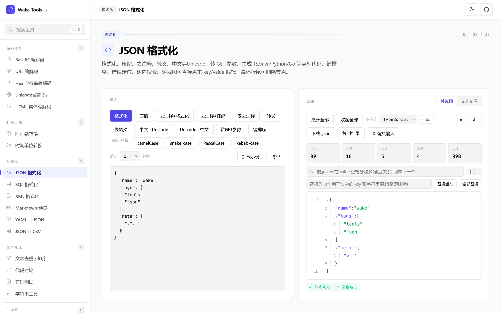

<a name="readme-top"></a>

<div align="center">
  
</div>

<div align="center">

# Wake Tools

**A grab-and-go toolbox for developers**

31 everyday utilities on a single page. Open it and start using it. No sign-up, no backend.

[![GitHub stars][stars-shield]][stars-url]
[![GitHub forks][forks-shield]][forks-url]
[![License][license-shield]][license-url]
[![Version][version-shield]][version-url]
[![Last commit][commit-shield]][commit-url]

[Live site][site-url] · [Report an issue][issues-url]

</div>

---

## Contents

<details>
<summary>Click to expand</summary>

- [About](#about)
- [Screenshots](#screenshots)
- [Tools](#tools)
- [Features](#features)
- [Quick Start](#quick-start)
- [Usage](#usage)
- [Tech Stack](#tech-stack)
- [Project Layout](#project-layout)
- [Adding a Tool](#adding-a-tool)
- [License](#license)

</details>

## About

Wake Tools is a static toolbox for the small jobs developers keep redoing by hand. Timestamp conversion, JSON formatting, Base64, JWT decoding, UUID generation: all of it lives on one page.

Everything runs in your own browser. The JSON you paste, the token you decode, the password you generate: none of it leaves your machine, and the tools keep working offline.

Live site: <https://tools.uwakeme.top/>

## Screenshots

<div align="center">
  
</div>

<details>
<summary>Expand: dark theme and the JSON tool page</summary>




</details>

## Tools

31 tools in 9 categories. Tool names below are the labels you see in the app sidebar.

### Encoding

| Tool | What it does |
| --- | --- |
| Base64 编解码 | Encode and decode Base64, UTF-8 Chinese included |
| URL 编解码 | Percent-encode and decode, in full-URL or component mode |
| Hex 字符串编解码 | Turn text into a hex string and back |
| Unicode 编解码 | Swap Chinese characters and `\uXXXX` escapes |
| HTML 实体编解码 | Escape and unescape HTML entities such as `&lt;` `&gt;` `&amp;` |

### Date and Time

| Tool | What it does |
| --- | --- |
| 时间戳转换 | Convert between Unix timestamps and date-times, seconds or milliseconds |
| 时间单位转换 | Convert seconds, minutes, hours, days, weeks, with add and subtract |

### Formatters

| Tool | What it does |
| --- | --- |
| JSON 格式化 | Format, minify, strip comments, escape, turn into a GET query, emit typed code, edit and delete inside the tree view |
| SQL 格式化 | Uppercase keywords and indent SQL statements |
| XML 格式化 | Pretty-print and minify XML |
| Markdown 预览 | Type Markdown on the left, watch it render on the right |
| YAML ↔ JSON | Convert between YAML and JSON, basic syntax |
| JSON ↔ CSV | Convert between a JSON array of objects and CSV, with quote escaping and type inference |

### Text Processing

| Tool | What it does |
| --- | --- |
| 文本去重 / 排序 | Deduplicate and sort by line, count lines and characters |
| 代码对比 | Compare two blocks of text line by line with LCS, side-by-side or unified |
| 正则测试 | Try a regular expression as you type, with capture groups highlighted |
| 字符串工具 | Length, reverse, repeat, pad, replace, change case |

### Generators

| Tool | What it does |
| --- | --- |
| UUID 生成 | Generate UUID v4 in batches |
| 随机密码 | Generate strong random passwords with your own length and character sets |
| 密钥 / Token 生成 | Generate API keys, secrets, and random tokens, with the entropy noted |
| Lorem Ipsum | Generate placeholder text |
| Hash 生成 | Hash text with MD5, SHA-1, SHA-256, or SHA-512 |
| 假数据生成 | Generate test names, emails, phone numbers, ID numbers, addresses |

### Color

| Tool | What it does |
| --- | --- |
| 颜色值转换 | Convert between HEX, RGB, and HSL, with a palette preview |

### Numbers

| Tool | What it does |
| --- | --- |
| 进制转换 | Convert between base 2 and base 36 |
| 字节单位转换 | Convert B, KB, MB, GB, TB in binary (1024) or decimal (1000) |

### Network Debugging

| Tool | What it does |
| --- | --- |
| JWT 解码 | Read the header, payload, and signature of a JWT (no signature verification) |
| URL 解析 | Break a URL into scheme, host, path, and query |
| HTTP Header 解析 | Turn HTTP headers into a readable table |

### Misc

| Tool | What it does |
| --- | --- |
| Cron 表达式 | Parse a cron expression and show the next 5 run times |
| ASCII 表 | Look up ASCII and Unicode characters |

<p align="right">(<a href="#readme-top">back to top</a>)</p>

## Features

- All 31 tools run locally in the browser. What you type stays on your machine.
- Press `⌘K` / `Ctrl+K`, or just `/`, to jump to the search box and filter the sidebar as you type.
- One click between light and dark themes. The choice is remembered between visits.
- Input on a tool page survives a detour to another tool, and clears when you close the tab.
- A service worker pre-caches the shell, so a revisit on a slow connection opens instantly and cached tools keep working with no network at all.
- On phones the sidebar collapses behind a menu button. Nothing breaks at 375px wide.
- Keyboard friendly: sensible `Tab` order, and `Esc` clears the search.

## Quick Start

Just open it: <https://tools.uwakeme.top/>

To run it locally and change things:

**Requirements**

- Node.js 18 or newer. It is only there to run wrangler, the project itself has no build step.
- A modern browser.

**Clone and start**

```bash
git clone https://github.com/uwakeme/wake_tools.git
cd wake_tools
npx wrangler dev
```

Head to <http://localhost:8787> and the home page loads.

**Deploy to Cloudflare**

```bash
npm install -g wrangler   # once is enough
npx wrangler deploy
```

Wrangler prints a `*.workers.dev` address when the deploy finishes.

> [!NOTE]
> There is no `package.json` here, and no build, lint, or test command. Push a commit and the site redeploys.

## Usage

**Find a tool**

Press `⌘K` (Windows: `Ctrl+K`) or `/` to focus the search box, then type a tool name or any word from its description. `Esc` clears the field.

**Jump straight to a tool**

Every tool has its own hash route, so you can bookmark or share one:

```text
https://tools.uwakeme.top/#/json
https://tools.uwakeme.top/#/jwt
https://tools.uwakeme.top/#/timestamp
```

**Switch themes**

The moon and sun button in the top bar. Both palettes have been checked against every tool page.

**Keep your input**

Fill in a tool, switch to another one, come back: your text is still there. It lives in sessionStorage, so closing the tab clears it and nothing sensitive is written to disk.

**Copy the result**

Every output area has a copy button that drops the value into your clipboard.

## Tech Stack

| Layer | Choice |
| --- | --- |
| UI | Plain HTML, CSS, and JavaScript. No framework, no build step |
| Styling | CSS variables drive both themes. JetBrains Mono loads asynchronously and only covers digits and code |
| Icons | Inline SVG, produced by a single `NS.IC` factory |
| Hosting | Cloudflare Workers in assets mode, serving the repository root as static files |
| Caching | Long-lived headers plus a runtime cache in the service worker |
| Offline | The service worker precaches the home page and the versioned js and css files |

## Project Layout

```text
wake_tools/
├── index.html         # Single entry page, loads icons → utils → tools → app in order
├── _headers           # Cloudflare cache policy
├── sw.js              # Service worker: network-first for navigation, cache-first for assets
├── css/
│   └── style.css      # Site-wide styles and theme variables
├── js/
│   ├── icons.js       # SVG icon constants
│   ├── utils.js       # Copy, toast, debounce, and other shared helpers
│   ├── tools.js       # Registry and implementation of all 31 tools
│   └── app.js         # Routing, search, theme toggle
├── assets/
│   └── banner.svg     # README banner
└── wrangler.jsonc     # Cloudflare Workers configuration
```

## Adding a Tool

Every tool lives in `js/tools.js`, split across two parts:

- `NS.TOOLS` holds the metadata for each tool (`id`, `group`, `icon`, `name`, `desc`). The sidebar and the home page cards both read from it.
- `NS.Tools` holds one factory per `id`. Each returns `{ view, bind }`, where `view` renders the markup and `bind` attaches the event handlers.

To add one:

1. Add the icon constant in `js/icons.js`
2. Add the metadata to `NS.TOOLS` and the implementation to `NS.Tools` in `js/tools.js`
3. Bump the `?v=N` query string for that script in `index.html`

Step 3 is not optional. `_headers` marks `/js/*` and `/css/*` as immutable for a year, so without a version bump returning visitors keep the old file.

> [!TIP]
> There is no automated test suite, so check your work in the browser: the tool shows up in search, the route resolves, empty and oversized input does not break anything, the copy button works, both themes still line up, and nothing overflows at 375px.

The rest of the conventions (code style, commit messages, who owns which file) live in [AGENTS.md](./AGENTS.md).

## License

MIT. See [LICENSE](./LICENSE).

## Other Languages

- [简体中文](./README.md)

---

[stars-shield]: https://img.shields.io/github/stars/uwakeme/wake_tools?style=for-the-badge
[stars-url]: https://github.com/uwakeme/wake_tools/stargazers
[forks-shield]: https://img.shields.io/github/forks/uwakeme/wake_tools?style=for-the-badge
[forks-url]: https://github.com/uwakeme/wake_tools/network/members
[license-shield]: https://img.shields.io/github/license/uwakeme/wake_tools?style=for-the-badge
[license-url]: https://github.com/uwakeme/wake_tools/blob/main/LICENSE
[version-shield]: https://img.shields.io/github/v/release/uwakeme/wake_tools.svg?style=for-the-badge
[version-url]: https://github.com/uwakeme/wake_tools/releases
[commit-shield]: https://img.shields.io/github/last-commit/uwakeme/wake_tools?style=for-the-badge
[commit-url]: https://github.com/uwakeme/wake_tools/commits/main
[site-url]: https://tools.uwakeme.top/
[issues-url]: https://github.com/uwakeme/wake_tools/issues
