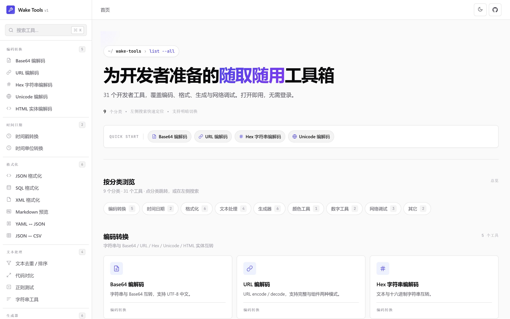
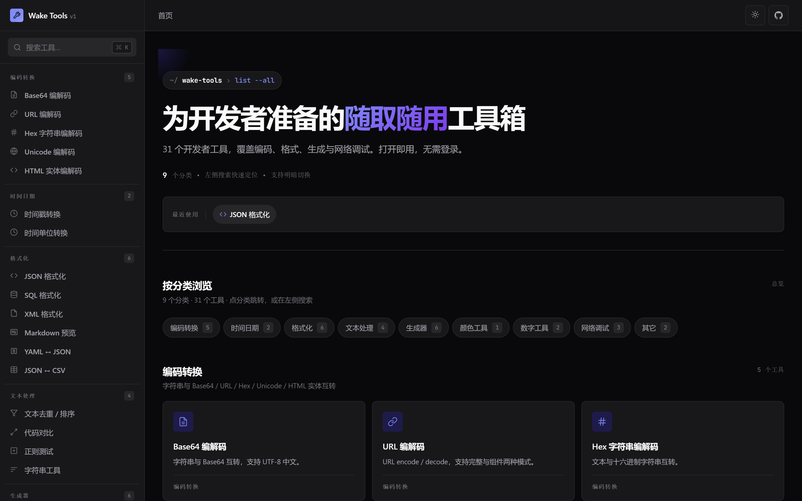
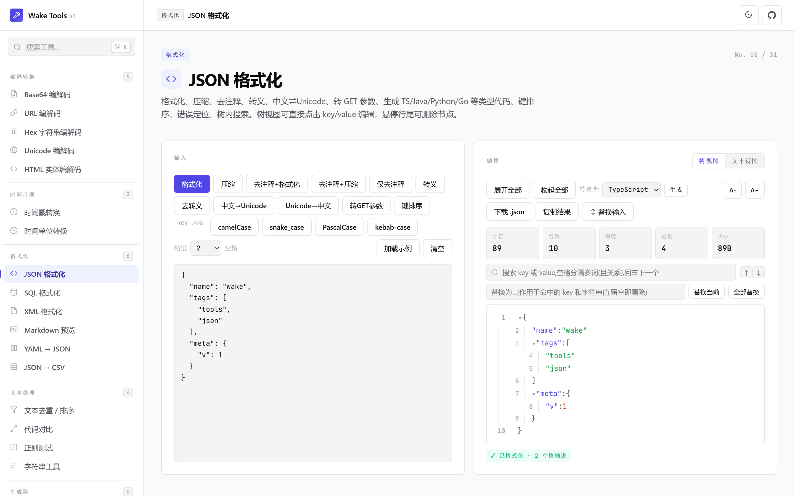

<a name="readme-top"></a>

<div align="center">
  
</div>

<div align="center">

# Wake Tools

**为开发者准备的随取随用工具箱**

31 个常用小工具，一个页面全搞定。打开即用，无需登录，无需后端。

[![GitHub stars][stars-shield]][stars-url]
[![GitHub forks][forks-shield]][forks-url]
[![License][license-shield]][license-url]
[![Version][version-shield]][version-url]
[![Last commit][commit-shield]][commit-url]

[在线使用][site-url] · [GitHub 源码][repo-url] · [问题反馈][issues-url]

</div>

---

## 目录

<details>
<summary>点击展开</summary>

- [关于](#关于)
- [界面预览](#界面预览)
- [工具一览](#工具一览)
- [功能特性](#功能特性)
- [快速开始](#快速开始)
- [使用说明](#使用说明)
- [技术栈](#技术栈)
- [项目结构](#项目结构)
- [开发新工具](#开发新工具)
- [License](#license)

</details>

## 关于

Wake Tools 是一套纯静态的开发者工具箱。时间戳转换、JSON 格式化、Base64 编解码、JWT 解码、UUID 生成这些日常要反复手搓的小活，都收在一个页面里。

所有计算都在你自己的浏览器里跑。你贴进去的 JSON、Token、密码不会发往任何服务器，断网也能用。

线上地址：<https://tools.uwakeme.top/>

## 界面预览

<div align="center">
  
</div>

<details>
<summary>展开：深色主题与 JSON 工具页</summary>





</details>

## 工具一览

共 31 个工具，分 9 类。

### 编码转换

| 工具 | 能做什么 |
| --- | --- |
| Base64 编解码 | 字符串与 Base64 互转，支持 UTF-8 中文 |
| URL 编解码 | URL encode / decode，支持完整与组件两种模式 |
| Hex 字符串编解码 | 文本与十六进制字符串互转 |
| Unicode 编解码 | 中文字符与 `\uXXXX` 转义互转 |
| HTML 实体编解码 | HTML 实体（`&lt;` `&gt;` `&amp;` 等）转义与反转义 |

### 时间日期

| 工具 | 能做什么 |
| --- | --- |
| 时间戳转换 | Unix 时间戳与日期时间互转，支持秒 / 毫秒 |
| 时间单位转换 | 秒 / 分 / 时 / 天 / 周换算，支持加减运算 |

### 格式化

| 工具 | 能做什么 |
| --- | --- |
| JSON 格式化 | 格式化、压缩、去注释、转义、转 GET、生成类型代码、树内编辑删除 |
| SQL 格式化 | SQL 语句关键字大写、缩进美化 |
| XML 格式化 | XML 美化、压缩 |
| Markdown 预览 | 左侧写 Markdown，右侧实时渲染预览 |
| YAML ↔ JSON | YAML 与 JSON 互转，支持基础语法 |
| JSON ↔ CSV | JSON 对象数组与 CSV 互转，支持引号转义与类型推断 |

### 文本处理

| 工具 | 能做什么 |
| --- | --- |
| 文本去重 / 排序 | 按行去重、排序，统计行数与字符数 |
| 代码对比 | LCS 逐行比较两段文本，支持并排与流式两种视图 |
| 正则测试 | 实时测试正则表达式，支持捕获组高亮 |
| 字符串工具 | 长度统计、反转、重复、填充、替换、大小写等常用操作 |

### 生成器

| 工具 | 能做什么 |
| --- | --- |
| UUID 生成 | 批量生成 UUID v4 |
| 随机密码 | 生成高强度随机密码，可选字符集与长度 |
| 密钥 / Token 生成 | 生成 API Key、Secret、随机 Token，标注熵强度 |
| Lorem Ipsum | 生成占位文本 |
| Hash 生成 | 计算文本的 MD5 / SHA-1 / SHA-256 / SHA-512 哈希值 |
| 假数据生成 | 批量生成测试用姓名、邮箱、手机号、身份证、地址 |

### 颜色工具

| 工具 | 能做什么 |
| --- | --- |
| 颜色值转换 | HEX / RGB / HSL 互转，附带色板预览 |

### 数字工具

| 工具 | 能做什么 |
| --- | --- |
| 进制转换 | 2~36 进制互转 |
| 字节单位转换 | B / KB / MB / GB / TB，支持二进制（1024）与十进制（1000） |

### 网络调试

| 工具 | 能做什么 |
| --- | --- |
| JWT 解码 | 解析 JWT 的 Header / Payload / Signature（不验签） |
| URL 解析 | 拆分 URL 的协议、域名、路径、参数等 |
| HTTP Header 解析 | 解析 HTTP 头部为可读表格 |

### 其它

| 工具 | 能做什么 |
| --- | --- |
| Cron 表达式 | 解析 Cron 表达式，展示未来 5 次执行时间 |
| ASCII 表 | 查询 ASCII / Unicode 字符 |

<p align="right">(<a href="#readme-top">back to top</a>)</p>

## 功能特性

- 31 个工具全部在浏览器本地运行，输入内容不出本机
- ⌘K / Ctrl+K 或者按 `/` 直接聚焦搜索框，左侧列表实时过滤
- 明暗主题一键切换，选择记在 localStorage，刷新不丢
- 工具页的输入内容按会话保存，切走再回来还在，关掉标签页自动清空
- Service Worker 预缓存，弱网回访秒开，断网也能继续用打开过的工具
- 手机上侧边栏收进汉堡菜单，375px 宽度不破版
- 键盘可达：`Tab` 顺序合理，`Esc` 清空搜索

## 快速开始

线上直接用：<https://tools.uwakeme.top/>

本地跑起来改代码：

**前置条件**

- Node.js 18 或更高（只用来跑 wrangler，项目本身没有构建步骤）
- 现代浏览器

**拉代码并启动**

```bash
git clone https://github.com/uwakeme/wake_tools.git
cd wake_tools
npx wrangler dev
```

打开 <http://localhost:8787> 就能看到首页。

**部署到 Cloudflare**

```bash
npm install -g wrangler   # 只需要装一次
npx wrangler deploy
```

部署完 wrangler 会输出一个 `*.workers.dev` 域名。

> [!NOTE]
> 项目没有 `package.json`，也没有 build / lint / test 命令。改完源码直接 `git push` 就会重新部署。

## 使用说明

**搜索工具**

按 `⌘K`（Windows 是 `Ctrl+K`）或 `/` 聚焦左侧搜索框，输入工具名或描述里的关键词即可过滤。按 `Esc` 清空。

**直达某个工具**

每个工具都有独立的 hash 路由，收藏或分享链接都行：

```text
https://tools.uwakeme.top/#/json
https://tools.uwakeme.top/#/jwt
https://tools.uwakeme.top/#/timestamp
```

**切换主题**

右上角月亮 / 太阳图标，明暗两套配色都经过排版校对。

**输入内容保留**

在工具页填了东西，切换到别的工具再切回来，内容还在。这是会话级（sessionStorage）的，关掉标签页就没了，敏感内容不落盘。

**复制结果**

每个工具的输出区都带复制按钮，点一下就进剪贴板。

## 技术栈

| 层 | 选型 |
| --- | --- |
| 界面 | 原生 HTML / CSS / JS，无框架、无构建步骤 |
| 样式 | CSS 变量统一主题色，JetBrains Mono 异步加载只管数字和代码字形 |
| 图标 | 内联 SVG，由 `NS.IC` 工厂函数统一生成 |
| 托管 | Cloudflare Workers（assets 模式），根目录直接当静态资源 |
| 缓存 | `_headers` 定长缓存 + Service Worker 运行时缓存 |
| 离线 | Service Worker 预缓存首页与带版本号的 js / css |

## 项目结构

```text
wake_tools/
├── index.html         # 单页入口，按顺序加载 icons → utils → tools → app
├── _headers           # Cloudflare 缓存策略
├── sw.js              # Service Worker：导航网络优先，资源缓存优先
├── css/
│   └── style.css      # 全站样式与主题变量
├── js/
│   ├── icons.js       # SVG 图标常量
│   ├── utils.js       # 复制、toast、防抖等通用函数
│   ├── tools.js       # 全部 31 个工具的注册表与实现
│   └── app.js         # 路由、搜索、主题切换
├── assets/
│   └── banner.svg     # README 顶图
└── wrangler.jsonc     # Cloudflare Workers 配置
```

## 开发新工具

工具全部集中在 `js/tools.js` 里，分两部分：

- `NS.TOOLS` 数组：每个工具的元数据（`id`、`group`、`icon`、`name`、`desc`），侧边栏和首页卡片都读它
- `NS.Tools` 工厂：每个 `id` 对应一个返回 `{ view, bind }` 的函数，`view` 渲染 HTML，`bind` 挂事件

加一个工具大致是这么走：

1. 在 `js/icons.js` 里加图标常量
2. 在 `js/tools.js` 的 `NS.TOOLS` 里加元数据，在 `NS.Tools` 里加实现
3. 在 `index.html` 里 bump 对应脚本的 `?v=N`

第 3 步不能忘。`_headers` 把 `/js/*` 和 `/css/*` 设成了一年 immutable 缓存，版本号不变的话老用户一年内看不到更新。

> [!TIP]
> 项目没有自动化测试，改完手动在浏览器里过一遍：搜索能搜到、路由跳得对、空串和超长串不炸、复制按钮能用、明暗主题都不破版、375px 宽度不溢出。

更多约定（代码风格、commit 规范、目录职责）写在 [AGENTS.md](./AGENTS.md) 里。

## License

MIT，详见 [LICENSE](./LICENSE)。

## 其他语言

- [English](./README.en.md)

---

[stars-shield]: https://img.shields.io/github/stars/uwakeme/wake_tools?style=for-the-badge
[stars-url]: https://github.com/uwakeme/wake_tools/stargazers
[forks-shield]: https://img.shields.io/github/forks/uwakeme/wake_tools?style=for-the-badge
[forks-url]: https://github.com/uwakeme/wake_tools/network/members
[license-shield]: https://img.shields.io/github/license/uwakeme/wake_tools?style=for-the-badge
[license-url]: https://github.com/uwakeme/wake_tools/blob/main/LICENSE
[version-shield]: https://img.shields.io/github/v/tag/uwakeme/wake_tools.svg?style=for-the-badge
[version-url]: https://github.com/uwakeme/wake_tools/releases
[commit-shield]: https://img.shields.io/github/last-commit/uwakeme/wake_tools?style=for-the-badge
[commit-url]: https://github.com/uwakeme/wake_tools/commits/main
[site-url]: https://tools.uwakeme.top/
[repo-url]: https://github.com/uwakeme/wake_tools
[issues-url]: https://github.com/uwakeme/wake_tools/issues
